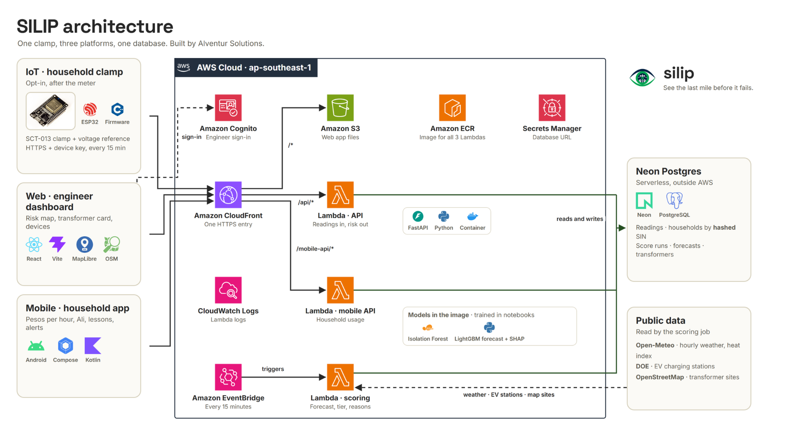

<div align="center">


# SILIP

### See the last mile before it fails.

Opt-in household sensing and transformer risk visibility for a more resilient grid.

[](#team)
[](#tech-stack)
[](#tech-stack)
[](#tech-stack)
[](#tech-stack)

[How it works](#how-it-works) · [Architecture](#architecture) · [Getting started](#getting-started) · [API](#api) · [Documentation](#documentation) · [Pitch deck](https://canva.link/j1ygrlm5g50qc6u)

</div>

> [!IMPORTANT]
> **SILIP is a prototype.** The clamp measures whole-home electrical load; it does not identify appliances,
> control circuits, or replace a billing meter. Household examples, grid events, and some transformer
> forecasts are simulated or illustrative and are labeled in the app. The Android app's read API is a
> restricted development PoC: only `silip-esp32-test` is allow-listed in dev, and the production allowlist
> is empty.

## Contents

- [Why SILIP](#why-silip)
- [How it works](#how-it-works)
- [Architecture](#architecture)
- [Tech stack](#tech-stack)
- [Repository layout](#repository-layout)
- [Getting started](#getting-started)
- [Commands](#commands)
- [API](#api)
- [Security and data](#security-and-data)
- [Deployment](#deployment)
- [Documentation](#documentation)
- [Team](#team)

## Why SILIP

Distribution teams often have limited visibility into load on the final stretch between a transformer
and the homes it serves. SILIP explores how opt-in household clamp readings can add a neighborhood-level
signal: the system groups readings by serving transformer, forecasts near-term load, and gives engineers
a map and supporting reasons to help prioritize field checks.

The Android app gives participating households a simpler view of energy use and estimated cost, along with
learning content and optional away reminders. These are decision-support features; the system does not
switch electricity off or claim which appliance caused a reading.

## How it works

| Step | What happens |
| --- | --- |
| **1 · Measure** | An ESP32 node with a split-core current transformer samples whole-home load and sends a reading over HTTPS about every 15 minutes. |
| **2 · Receive** | CloudFront routes device reports to the API Lambda. Device keys authorize IoT posts; engineers use Cognito for dashboard data. |
| **3 · Score** | A scheduled scoring Lambda combines transformer aggregates with forecast models and public context such as weather and EV charging locations. |
| **4 · Review** | Results are stored in Neon Postgres and shown in the engineer dashboard as transformer risk, forecast, confidence, and reasons. |
| **5 · Understand** | The Android app shows household usage through a separate, read-only mobile PoC route. Its development allowlist is limited to the demo device. |

## Architecture

The diagram below is the project architecture reference supplied by the team.

<p align="center">
  
</p>

The main data path is **clamp → CloudFront → API Lambda → Neon**. EventBridge starts the scoring
Lambda every 15 minutes; its forecasts and risk results are persisted for the engineer dashboard. The
mobile app's `/mobile-api/*` requests go to a separate read-only Lambda. AWS resources are in
`ap-southeast-1`; Neon Postgres is managed outside AWS.

## Tech stack

| Area | Technologies |
| --- | --- |
| IoT | ESP32, SCT-013-000 current transformer, PlatformIO / C++ |
| API and scoring | Python, FastAPI, Mangum, AWS Lambda, EventBridge |
| Web dashboard | React, TypeScript, Vite, MapLibre GL, OpenStreetMap |
| Android app | Kotlin, Jetpack Compose, Material 3 |
| Data | Neon Postgres; CSV and generated fixtures for local or demo use |
| Models | LightGBM forecasts, Isolation Forest anomaly signals, rules-based risk scoring, SHAP explanations |
| Infrastructure | Terraform, CloudFront, S3, ECR, Cognito, Secrets Manager, CloudWatch |

Training and evaluation run in `silip/notebooks/`; inference code and exported model artifacts live in
`silip/ml/`. The API loads scoring results rather than training models during requests.

## Repository layout

```text
.
├── docs/assets/          # SILIP logo and architecture image used by this README
├── silip/                # Python API, React web app, IoT firmware, ML, data, Terraform
│   ├── api/
│   ├── web/
│   ├── iot/
│   ├── ml/
│   ├── notebooks/
│   └── infra/
└── silip-app/            # Native Android household app (Kotlin + Compose)
```

## Getting started

### API and web dashboard

Install `uv`, Python, Node.js, and npm. From the repository root:

```sh
cd silip
make setup
cp .env.example .env
cp web/.env.example web/.env.local
```

The examples configure local simulated data and development authentication. Start the API and web app in
separate terminals, both from `silip/`:

```sh
make api
```

```sh
make web
```

Open <http://localhost:5173>. The Vite dev server forwards `/api` calls to the API at
<http://localhost:8000>. The API's OpenAPI page is at <http://localhost:8000/docs>.

### Android app

Open `silip-app/` in Android Studio, or build a debug APK with the Gradle wrapper:

```sh
cd ../silip-app
./gradlew assembleDebug
```

The debug build uses the configured SILIP dev API by default. To point it elsewhere, pass
`-PsilipApiBaseUrl=https://your-cloudfront-domain`.

## Commands

Run the Python and web commands from `silip/`.

| Command | What it does |
| --- | --- |
| `make setup` | Sync Python dependencies and install web dependencies |
| `make api` / `make web` | Run the local FastAPI server / Vite dashboard |
| `make sim SIM_SCALE=test` | Generate a small simulated dataset |
| `make notebooks` | Execute the data, training, evaluation, and export notebooks in order |
| `make backtest` | Compare model strategies against their baselines on held-out simulated data |
| `make test` / `make lint` | Run Python and web tests / project lint checks |
| `make schemas` | Regenerate reading schemas and the web API client types |
| `make tf-validate` | Validate the dev and prod Terraform configurations |
| `make iot-test` | Run the PlatformIO native firmware tests |

`make db` applies the SQL schema to the configured database. Confirm the target database before using it.

## API

The API is served behind CloudFront. See the [auth contract](silip/docs/auth-contract.md) for the full
route list and access rules.

| Area | Route | Access |
| --- | --- | --- |
| Health | `GET /api/health` | Public |
| Engineer dashboard | `/api/v1/dashboard/*`, `/api/v1/transformers/*`, `/api/v1/clamps/*`, `/api/v1/weather/*`, `/api/v1/ev/*`, `/api/v1/outages/*`, `/api/v1/devices/*` | Cognito engineer account |
| IoT ingestion | `POST /api/v1/devices/{device_id}/readings` | Registered device key (`X-Device-Key`) |
| Mobile usage PoC | `GET /mobile-api/v1/devices/{clamp_id}/usage` | No household sign-in today; only explicitly allow-listed demo IDs are returned |

The mobile PoC currently allows `silip-esp32-test` in dev and no IDs in prod. Do not add real household
devices until the household authentication and data-access path is approved and implemented.

## Security and data

- Household participation is opt-in. Raw Service ID Numbers are not stored in app code or exposed to
  engineers; the data model uses salted `sin_hash` values.
- Engineers see transformer aggregates, not a household's individual usage history.
- IoT devices post through HTTPS using a device key. The Android app never receives that key or database
  credentials.
- Simulated readings and forecasts must keep their `is_simulated` provenance label in storage, API
  responses, and UI.
- Keep local credentials in ignored `.env` files and deployed database credentials in AWS Secrets
  Manager. Never put secrets in `VITE_*` variables or commit `secrets.h`, `.env`, Terraform state, or
  real household data.
- The clamp measures whole-home electrical load. SILIP is not a certified meter, an appliance detector,
  or an automatic protection or control system.

## Deployment

Terraform environments live in `silip/infra/envs/dev` and `silip/infra/envs/prod`. The web build is
hosted in S3 behind CloudFront; the API, mobile PoC, and scoring jobs use separate Lambda handlers from
the shared container image. Follow the [deployment notes](silip/docs/deploy.md), inspect each Terraform
plan, and use the intended AWS profile and region before applying changes.

## Documentation

| Document | What it covers |
| --- | --- |
| [System specification](silip/docs/SPEC.md) | Domain, payload, data, and modeling notes |
| [Authentication contract](silip/docs/auth-contract.md) | Cognito roles, API access, and the mobile PoC exception |
| [IoT management](silip/docs/iot-management.md) | Registering devices and assigning them to transformers |
| [IoT payload spec](silip/iot/PAYLOAD_SPEC.md) | Device reading fields and transmission format |
| [Android app guide](silip-app/README.md) | Household app behavior, build, and current PoC limitations |
| [Household energy features](silip-app/docs/household-energy-features.md) | Usage estimates, forecasts, solar, and away reminders |
| [Demo runbook](silip/docs/demo/runbook.md) | Rehearsal flow and simulated bench demo |
| [Web guide](silip/web/README.md) | React app structure and local sign-in modes |

## Team

Built by **Alventur Solutions** for the **Meralco IDOL Hackathon 2026**.

**Presentation:** [Open the SILIP pitch deck in Canva](https://canva.link/j1ygrlm5g50qc6u)

**Status:** Hackathon prototype. No open-source license has been selected; all rights are reserved by
the team.
